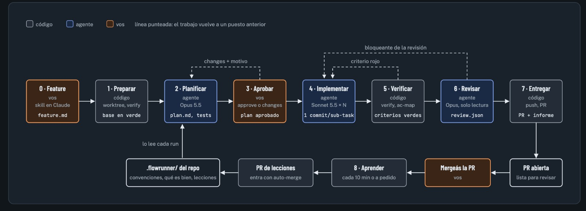

# flowrunner

Le pedís una feature a Claude Code y flowrunner la lleva sola hasta una PR lista para revisar. Vos
intervenís en dos momentos: cuando aprobás el plan y cuando revisás la PR. Todo lo demás corre sin
vos, en segundo plano, y cada repo tiene un cerebro en `.flowrunner/` que aprende de tus correcciones.

## Instalar

Una sola vez por máquina. Necesitás macOS, Node 24 o más nuevo, pnpm 10, git y Claude Code con tu
sesión abierta.

1. Instalá las herramientas que usa flowrunner y abrí sesión en GitHub:

   ```bash
   npm i -g pnpm@10 @nanonets/graft
   ```

   ```bash
   gh auth login
   ```

2. Cloná flowrunner en la carpeta que quieras e instalá sus dependencias:

   ```bash
   git clone https://github.com/anegri93/flowrunner.git
   ```

   ```bash
   cd flowrunner && pnpm install
   ```

3. Desde esa misma carpeta, dejá el comando `flowrunner` en tu PATH:

   ```bash
   ln -s "$PWD/bin/flowrunner.js" ~/.local/bin/flowrunner
   ```

Ese link es solo para arrancar. `flowrunner init <repo> --aplicar` deja el flowrunner que corre runs en
`~/.flowrunner/app`, un worktree de este repo en `origin/main` con sus propias dependencias, y apunta ahí
el comando, el job de launchd, la skill y el plugin de Orca. Para actualizarlo a lo último de `main`:

```bash
flowrunner self-update
```

No actualiza con un run corriendo: los que esperan aprobación, detenidos o en cola siguen con el código
nuevo. El checkout que clonaste queda para desarrollar, y cambiar de rama ahí no afecta a ningún run.
`flowrunner doctor` avisa si el comando o el job de launchd apuntan a otro lado. `self-update` instala con
`pnpm install --frozen-lockfile`: pnpm tiene que estar en el PATH de quien lo corre.

## Sumar un repo

Una vez por repo. El repo tiene que estar en GitHub y su rama base en verde. Si fija Node en `.nvmrc` o
`.node-version`, setup, agentes y verify corren con esa versión, instalada con nvm, fnm, volta o
Homebrew; si no está instalada, verify no corre y el run se detiene diciendo cómo instalarla.

1. Mirá qué hay y qué falta. No toca nada:

   ```bash
   flowrunner init ~/ruta/al/repo
   ```

2. Aplicalo. Registra el repo, instala la skill de Claude Code, el chequeo cada 10 minutos y el comando,
   y abre una PR con el cerebro del repo en `.flowrunner/`:

   ```bash
   flowrunner init ~/ruta/al/repo --aplicar
   ```

3. En esa PR, revisá la config que infirió, con el setup, los tests, el lint y el formateador, y el borrador de `contexto.md`, `convenciones.md` y
   `que-es-bien.md`: init lo redacta leyendo primero lo que el repo ya documenta (`CLAUDE.md`,
   `AGENTS.md`, reglas de agentes, `docs/`, el CI) y después el código, y lo deja en una sección
   «Borrador de flowrunner init» con el commit del que salió. Cada regla cita su archivo y trae su
   severidad: `[bloqueante]`, `[aviso]` o `[lo chequea …]`, que revisar respeta. Si el CI corre algo
   que `verify.sh` no, la PR lo avisa. Corregí lo que no sea así y escribí tus reglas arriba de esa
   sección. Después mergeala: los runs leen el cerebro desde la rama
   base.

   El borrador vive en la rama base de GitHub: si en tu carpeta no lo ves, hacé `git pull`.

   Si el repo ya tenía su cerebro de antes, init no lo toca. Para sumarle el borrador leído del código,
   en su propia PR y debajo de lo que ya escribiste:

   ```bash
   flowrunner brain draft ~/ruta/al/repo
   ```

   Si la base ya tiene un borrador, por ejemplo uno de una versión anterior de init, `--reemplazar`
   lo cambia por uno nuevo en su PR. Lo que está arriba de la sección queda; la sección entera se
   reescribe.

4. Confirmá que quedó listo. Todo tiene que salir con ✓:

   ```bash
   flowrunner init ~/ruta/al/repo
   ```

## Usar

1. Abrí Claude Code en el repo y pedile la feature, como se la pedirías a una persona.
2. La skill te hace preguntas de a una, escribe la feature y la lanza. Desde ahí el run corre solo.
   Antes de lanzar, `feature check` avisa si un criterio usa un script que no existe o si solo se
   comprueba leyendo documentación.
3. Para ver cómo va, usá la pestaña de flowrunner en Orca o, en una terminal:

   ```bash
   flowrunner watch PIZ-1
   ```

4. Cuando el plan está listo, la etapa Aprobar dice «te espera». Tocá «Plan» para leerlo y después
   «Aprobar» o «Cambios» en la tarjeta del run. También podés pedirle a Claude que te lo muestre y
   decidir ahí.
5. flowrunner implementa, verifica, revisa y abre la PR.
6. Revisá la PR, corregí lo que haga falta y mergeala. En el próximo chequeo, que corre cada 10 minutos,
   flowrunner aprende de tus correcciones y cierra el run.

### Avisos

flowrunner te avisa en el escritorio cada vez que un run cambia de estado sin que se lo pidas: sale
de la cola y arranca, el plan te espera, se pausa por el límite de la suscripción o vuelve de la
pausa, se detiene, abre la PR o se cierra después del merge. Lo que hacés vos con un comando, desde
la terminal, Claude u Orca, no avisa: ya te lo dice la respuesta.

### Varias features del mismo repo a la vez

Hasta dos runs de un repo avanzan a la vez. Un run que espera tu aprobación o está en pausa no ocupa
lugar. El que no entra queda en cola y arranca solo cuando se libera un lugar, el más viejo primero.
Verify, los comandos de los criterios en verificar y probar usan tu entorno de desarrollo, así que
esos pasos se turnan entre runs. Si el plan que vas a aprobar toca los mismos archivos que otro run
con la PR sin cerrar, el plan te lo avisa. Para cambiar el tope:

```yaml
max_runs: 3 # de 1 a 8; por defecto 2
```

### Archivos fuera de git que necesitan los criterios

La copia de la feature sale de git: no tiene tus `.env`. Si los comandos de los criterios los
necesitan, como un e2e que levanta la app, listalos en `.flowrunner/config.yaml`:

```yaml
env_files: [.env.local] # se copian de tu checkout mientras corren los comandos de los criterios
```

Se copian solo mientras corren esos comandos (al comprobar que los criterios están en rojo, en cada
sub-task y en verificar) y se borran después. El agente no puede leerlos ni buscar en ellos, y nunca
entran en un commit. Sin ellos, un e2e que no puede levantar la app «falla» sin probar nada.

### Probar la feature en el entorno

Después de revisar, la fase probar usa la feature como lo harías vos: levanta el entorno de desarrollo
desde la copia de la feature, llama a la API y navega la plataforma con Chrome. Una prueba que falla
vuelve a su sub-task con la evidencia. Un criterio que no se pudo probar detiene el run: arreglás lo que
faltó y rehacés probar, o decidís entregar igual con `flowrunner accept-untested <run> "<por qué>"`, y
ese motivo queda en la PR. Para eso el repo dice cómo levantar el entorno en
`.flowrunner/config.yaml`; sin esto, probar se saltea con un aviso:

```yaml
probar:
  levantar: ./start.sh --local # siempre local: nunca contra datos reales; termina cuando está listo
  sigue_corriendo: false # true si levantar no termina, como un `pnpm dev`
  bajar: ./stop.sh # si levantar deja procesos desacoplados
  urls: # lo único a lo que llegan el navegador y la API
    api: http://localhost:3000
    web: http://localhost:5173
  servicios: # compartidos, como el Supabase local: pueden estar prendidos antes y quedar después
    correo: http://127.0.0.1:54324
  env_files: [apps/api/.env, apps/web/.env] # se copian de tu checkout a la copia de la feature
  notas: Entrá con el usuario de prueba que crea el seed, admin@local.test.
  espera_segundos: 300
  fallas: # lo que el agente puede provocar para probar el camino de error, por nombre
    kms_colgado:
      que: KMS acepta la conexión y no contesta
      simular: docker pause portal-localstack
      restaurar: docker unpause portal-localstack
  navegador_visible: false # true abre Chrome con ventana mientras prueba
```

El agente elige una falla por su nombre, nunca el comando, y al terminar flowrunner restaura las que
hayan quedado puestas. El video se entiende solo: antes de cada criterio, una placa con qué se prueba y
qué debería pasar; un cursor que marca cada clic; lo que se toca queda centrado en la pantalla; y al
final de cada criterio, el resultado marcado.

El agente no puede leer ni buscar en los `env_files`, y al terminar se borran de la copia de la feature.
Los `servicios` también los alcanzan el navegador y la API, pero no corren el código de la feature: un
Supabase local que ya usan los e2e puede estar prendido, y probar solo espera a que respondan.
Si algo ya responde en las `urls` antes de levantar, por ejemplo tu propio entorno, probar se detiene:
probar contra eso no probaría la feature. Cada prueba queda en el informe y en la PR. El log de cada
pedido a la API y el video de cada navegación quedan en `~/.flowrunner/runs/<id>/pruebas/`, y el
informe y la etapa Probar del panel de Orca los enlazan para que los revises.

## Cómo funciona



Cada run pasa por puestos en orden. Los grises los hace código, sin modelo; los azules, un agente; los
naranjas, vos.

| Puesto          | Quién          | Qué hace                                                                | Qué deja               |
| --------------- | -------------- | ----------------------------------------------------------------------- | ---------------------- |
| 0 · Feature     | vos            | La escribís conversando con la skill en Claude Code                     | `feature.md`           |
| 1 · Preparar    | código         | Una copia de trabajo aparte, dependencias instaladas y la base en verde | la base comprobada     |
| 2 · Planificar  | Opus           | Lee el código, escribe los tests de aceptación y divide en sub-tasks    | `plan.md` y los tests  |
| 3 · Aprobar     | vos            | Aprobás el plan o pedís cambios con tu motivo                           | el plan aprobado       |
| 4 · Implementar | Sonnet × N     | Cada sub-task en su propia copia, en paralelo si no se pisan            | un commit por sub-task |
| 5 · Verificar   | código         | Corre los criterios y el `verify.sh` del repo                           | los criterios en verde |
| 6 · Revisar     | Opus, solo lee | Compara el cambio con las convenciones del repo                         | la revisión            |
| 7 · Probar      | Sonnet         | Levanta el entorno con la feature y la usa por la API y el navegador    | las pruebas y el video |
| 8 · Entregar    | código         | Sube la rama y abre la PR, con lo que aprendió el run                   | la PR y el informe     |
| 9 · Aprender    | agente         | Después del merge, convierte tus correcciones en lecciones              | una PR de lecciones    |

Las líneas punteadas del diagrama son el trabajo que vuelve atrás: un criterio en rojo o un bloqueante de
la revisión o una prueba que falla en el entorno vuelven a implementar, y tus cambios al plan vuelven a planificar. Las lecciones llegan al
cerebro del repo, y el próximo run las lee.

Si un run se replanifica, el código de las sub-tasks que el plan nuevo no cambia se conserva: el
planificador lo ve en el worktree, lo marca con `conserva: true`, y implementar solo corre las
sub-tasks nuevas o cambiadas. Si no se puede comprobar que el plan nuevo no lo rompe, se reimplementa
(ADR 0024).

Los tests de aceptación quedan bloqueados: ninguna sub-task los puede tocar. Por eso, antes de
bloquearlos, flowrunner les pasa el lint del repo en modo arreglar y el formateador. Un error que el
lint no arregla solo rechaza el plan, y el planificador lo corrige antes de que lo veas.

Mientras trabajan, los agentes no pueden salirse de lo suyo: cada sub-task solo escribe dentro de su
alcance, y flowrunner lo controla en cada herramienta y otra vez sobre el diff.

## Qué pasa cuando algo falla

Cuando algo sale mal, el run se detiene y te pregunta. `flowrunner status <run>`, el aviso, watch y el
panel de Orca dicen el motivo, a qué sub-task se atribuye y tus respuestas, como comandos:

- `flowrunner fix <run> --unidad ST-n "<qué cambiar>"`: que esa sub-task lo corrija con tu instrucción,
  sobre el código que ya está.
- `flowrunner fix <run> --yo`: lo arreglás vos en el worktree de la feature, que el comando te dice, y
  después `flowrunner resume <run>` commitea tu cambio y vuelve a verificar. Podés commitear vos
  también: resume chequea todo lo que cambió desde `fix --yo`. No pasa un cambio que toque `.git`,
  cambie un test bloqueado del plan o agregue un secreto; un `CLAUDE.md`, sí.
- `flowrunner accept <run> "<por qué>"`: seguir a la fase siguiente igual. Tu motivo queda en el
  informe y en la PR.
- `flowrunner rerun <run> --desde planificar`: replanificar, o `flowrunner abort <run>` para cortarlo.

Cada run ofrece solo las que tienen sentido en su detención, y los comandos aceptan solo esas. Por
defecto, el primer rojo de verificar, revisar o probar ya es una pregunta. Si preferís que flowrunner
reintente solo antes de preguntarte, cada repo puede pedir vueltas automáticas:

```yaml
vueltas: 2 # de 0 a 3; por defecto 0. Un run toma el valor de cuando se creó
```

Una sub-task que falla se reintenta con el motivo. Cuando reintentar no tiene sentido, flowrunner corta
antes:

- **Un problema del entorno**, como una dependencia sin instalar, no se le devuelve a una sub-task:
  verificar reinstala y repite. Si sigue, se detiene y dice qué falta.
- **Una sub-task que no puede avanzar** también te pregunta, y las demás se integran igual. Si
  terminó sin cambiar nada, o el bloqueo no la dejó escribir, no se reintenta: el run se detiene al
  primer intento, con lo último que dijo y lo que se le rechazó.
- **Si el ciclo no converge**, y el repo pidió vueltas automáticas, un agente de solo lectura
  diagnostica si el problema está en el código de alguna sub-task, en el entorno, en un test bloqueado o
  en el plan, y actúa según eso. Con 0 vueltas no corre: decidís vos.
- **Un test bloqueado con un detalle que no cambia lo que prueba**, como un `let` que el lint quiere
  `const`, se repara: una sesión chica edita solo ese archivo, y flowrunner acepta el cambio solo si
  el test pasa con la feature y sigue fallando sin ella. El arreglo va en su propio commit y la PR lo
  muestra para que lo revises.

- **Un corte de red** se reintenta durante unos 7 minutos (a los 30 s, 2 min y 5 min) antes de
  detenerse; cuando vuelva la red, `flowrunner resume <run>`. **Una credencial rechazada** no se
  reintenta: te pide `flowrunner doctor` y después `resume`.

Todo tiene tope. Si el run se detiene, `flowrunner watch` y `flowrunner status` dicen el motivo y los
comandos exactos para seguir.

## Cómo aprende el cerebro

`.flowrunner/` es el cerebro del repo: su contexto, sus convenciones, qué es una buena PR y las lecciones.
Aprende de dos fuentes, y en las dos decidís vos:

- **Lo que al run le costó corregirse solo.** Si hubo vueltas o pediste cambios al plan, la PR de entrega
  trae lecciones propuestas en un commit aparte. Si una no te convence, la borrás antes de mergear.
- **Tus correcciones a la PR.** Después del merge, tus commits y comentarios se vuelven lecciones que
  entran por una PR chica con auto-merge.

## Ver un run en vivo

`flowrunner watch` muestra, al estilo de [agents-tree](https://github.com/anegri93/agents-tree), cada run
con sus fases y sub-tasks: el modelo, los tokens nuevos, los USD aproximados, el tiempo y el estado. Lo
que corre muestra en gris la herramienta que está usando y cuánto contexto arrastra. Se refresca cada 2
segundos; con las flechas elegís una fila, con Enter ves sus pasos y con `q` salís. Con `--once` la
dibuja una vez.

### En Orca

Si usás [Orca](https://www.onorca.dev), el plugin de [`orca/`](orca/README.md) suma una pestaña en la
barra derecha, con el ícono del cohete. Cada run es una tarjeta con su estado, su tiempo y las ocho
etapas del flujo, cada una con su tiempo. La que trabaja gira, y debajo dice qué está haciendo. Desde
ahí decidís lo que el run espera: aprobar o pedir cambios al plan, reanudar o rehacer un run detenido,
o responder su pregunta: «Arreglar ST-n» con lo que tiene que corregir, «Lo arreglo yo» o «Seguir
igual» con tu motivo.
Aprobar se habilita después de abrir el plan (el botón Plan o el link de la etapa Aprobar). Un plan
corregido se vuelve a abrir.
Al pie de cada run vivo, «Abortar el run» lo corta en cualquier etapa.
El botón de pasos de una sesión y «Plan» abren el archivo como pestaña de Orca. Tocar una etapa que ya
arrancó abre su detalle: los intentos, lo propio de la etapa, las decisiones, los rechazos y las
sesiones. Tocar una sub-task abre lo que tenía que hacer, lo que dice que hizo y su diff. Los dos salen
de `flowrunner report <run> --fase <fase>` y `--unidad ST-n`, que también sirven en la terminal.

Para instalarlo, con Orca abierto:

```bash
flowrunner orca install
```

Orca pide aprobarlo porque corre comandos en tu máquina: repetí el comando con el `--approve` que
imprime. Si mudás la carpeta de flowrunner, volvé a correrlo para que Orca la encuentre.

Los tokens nuevos son lo que cada fase leyó o escribió por primera vez, sin las relecturas de caché. El
costo de lo que corre es un mínimo, `≥ 2.97`, porque la salida se conoce al terminar. Los USD son el
equivalente de API: con la suscripción no se cobran, y lo que limita es su cupo.

## Comandos

| Comando                                        | Para qué                                      |
| ---------------------------------------------- | --------------------------------------------- |
| `flowrunner init <ruta> [--aplicar]`           | revisar y dejar listo un repo                 |
| `flowrunner brain draft <ruta>`                | proponer un borrador del cerebro en una PR    |
| `brain draft <ruta> --reemplazar`              | cambiar el borrador anterior por uno nuevo    |
| `flowrunner watch [run] [--json]`              | ver un run, o todos los activos, en vivo      |
| `flowrunner status [run]`                      | el estado de los runs, o de uno fase por fase |
| `flowrunner plan <run>`                        | el plan que espera aprobación                 |
| `flowrunner approve <run>`                     | aprobar el plan                               |
| `flowrunner changes <run> "<motivo>"`          | pedir cambios al plan                         |
| `flowrunner report <run>`                      | el informe del run                            |
| `flowrunner resume <run>`                      | retomar un run detenido                       |
| `flowrunner fix <run> --unidad ST-n "<qué>"`   | que una sub-task corrija lo que le pedís      |
| `flowrunner fix <run> --yo`                    | arreglarlo vos; después `resume`              |
| `flowrunner accept <run> "<por qué>"`          | seguir a la fase siguiente igual              |
| `flowrunner rerun <run> --desde <fase>`        | rehacer desde una fase                        |
| `flowrunner accept-untested <run> "<por qué>"` | entregar con criterios sin probar             |
| `flowrunner abort <run>`                       | cancelar un run                               |
| `flowrunner learn <run>`                       | aprender ya de una PR mergeada                |
| `flowrunner stats [proyecto]`                  | en qué fase se va el tiempo y el costo        |
| `flowrunner stats --runs [proyecto]`           | tiempo activo, costo y rechazos de cada run   |
| `flowrunner doctor`                            | qué le falta a esta máquina                   |
| `flowrunner self-update`                       | llevar el flowrunner que corre a `main`       |

`run` puede ser el id completo o la clave de la feature, como `PIZ-1`. Casi nunca hace falta escribirlos:
la skill de Claude Code los usa por vos.

## Autenticación

flowrunner usa tu suscripción de Claude: la sesión de Claude Code que ya tenés, con `auth: login` en
`~/.flowrunner/config.yaml`, que es lo que deja `init`, o un token de `claude setup-token` guardado en el
Keychain. La documentación del Agent SDK no permite ofrecer el login de claude.ai en productos de
terceros: antes de compartir flowrunner con otras personas hay que pasar a API key o confirmarlo con
Anthropic.

## Desarrollo

```bash
pnpm lint              # eslint, prettier y tsc
pnpm test              # unitarios, sin red ni suscripción
pnpm test:integration  # git real, CLI como proceso hijo, SDK y gh simulados
pnpm smoke             # SDK real con la suscripción
pnpm verify            # lint, unitarios e integración: la verificación local completa
```

- Diseño: [`docs/specs/2026-11-07-flowrunner-v0-design.md`](docs/specs/2026-11-07-flowrunner-v0-design.md)
- Plan de construcción: [`docs/tareas-construccion.md`](docs/tareas-construccion.md)
- Decisiones: [`docs/adr/`](docs/adr/)
